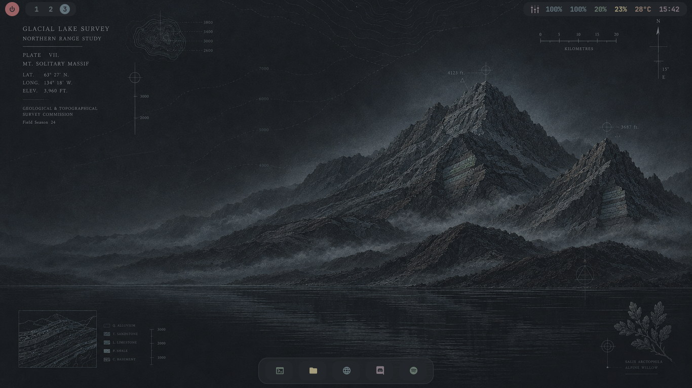

# dotfiles

Arch Linux + Hyprland setup

## Preview



## Overview

Personal configuration files (dotfiles) for an **Arch Linux** system running the
[Hyprland](https://hyprland.org/) tiling Wayland compositor. The Hyprland config
is written in **Lua** and split into modules under `hyprland/`.

| Component | Config in this repo | Software |
| --- | --- | --- |
| Compositor | `hyprland/` | Hyprland (Lua config) |
| Shell | `zsh/` | Zsh + Starship + Zinit |
| Terminal | `kitty/` | Kitty |
| Status bar | `waybar/` | Waybar (bar + dock) |
| Launcher / menus | `wofi/` | Wofi |
| Notifications | `mako/` | Mako |
| Wallpapers | `awww-daemon` (autostart) | awww |
| Editor | `nvim/` | Neovim + LazyVim |
| PDF reader | `zathura/` | Zathura |
| Image viewer | `imv/config` | imv |
| System information | `fastfetch/` | Fastfetch |
| Process priority | `ananicy/` | ananicy-cpp (submodule) |

## System Information

-   **OS**: Arch Linux
-   **WM/Compositor**: [Hyprland](https://hyprland.org/) (modular Lua config)
-   **Shell**: [Zsh](https://www.zsh.org/) with [Starship](https://starship.rs/) prompt
-   **Terminal**: [Kitty](https://sw.kovidgoyal.net/kitty/)
-   **Status Bar**: [Waybar](https://github.com/Alexays/Waybar)
-   **Application Launcher**: [Wofi](https://hg.sr.ht/~scoopta/wofi)
-   **Notification Daemon**: [Mako](https://github.com/emersion/mako)
-   **Wallpaper Manager**: [awww](https://codeberg.org/LGFae/awww)
-   **Editor**: [Neovim](https://neovim.io/) with [LazyVim](https://www.lazyvim.org/)
-   **PDF Reader**: [Zathura](https://github.com/pwmt/zathura)
-   **Image Viewer**: [imv](https://github.com/ocs2/go-imv)
-   **Process Scheduler**: [ananicy-cpp](https://github.com/CachyOS/ananicy-rules)

## Installation

1. Clone this repository with submodules:

    ```bash
    git clone --recurse-submodules https://github.com/jos-cab/dotfiles.git ~/.dotfiles
    cd ~/.dotfiles
    ```

    If you've already cloned the repository without submodules, run:

    ```bash
    git submodule update --init --recursive
    ```

2. Make the installation script executable and run it:

    ```bash
    chmod +x install.sh
    ./install.sh
    ```

    The installer requires backup authorization before changing `$HOME`, then creates links, optionally installs dependencies, configures Ananicy, checks PipeWire, and offers to set zsh as default shell.

    Use `./install.sh --yes` for non-interactive execution. It authorizes required backups but declines optional dependency installation. Without `--yes`, non-interactive execution aborts.

3. Configure local secrets if using 9Router:

    ```bash
    cp ~/.config/hypr/local.lua.example ~/.config/hypr/local.lua
    chmod 600 ~/.config/hypr/local.lua
    $EDITOR ~/.config/hypr/local.lua
    ```

    Keep `local.lua` outside Git.


### Safe conflict handling

Backups are always enabled. Existing files, directories, valid symlinks, and dangling symlinks move to `<filename>.bak`; collisions use `.bak.1`, `.bak.2`, and so on. Older backups are never replaced.

Declining backup or entering invalid input aborts before installation. The installer never deletes or silently replaces an existing destination.

On a filesystem failure, links created by that run are removed and backups are restored when possible. Any failed restores are reported with exact paths for manual recovery. Recovery cannot undo changes outside `$HOME`: package installation, `/etc/ananicy.d`, service state, Git submodule updates, or a changed login shell.

`~/.zshrc` is symlinked from `zsh/zshrc`; every other zsh file goes to `~/.config/zsh/`.

## Key Features

### Hyprland

-   Modular **Lua** config (`monitors`, `programs`, `autostart`, `environment`, `ecosystem`, `appearance`, `animations`, `layouts`, `input`, `keybinds`, `windowrules`)
-   Dynamic tiling with vim-like and arrow-key navigation
-   Multiple monitor support
-   Custom animations and transitions
-   Application-specific rules
-   Workspace management plus a scratchpad workspace
-   Runtime gap / border / rounding adjustment bound to the keyboard
-   Screenshot, OCR and QR-code capture helpers
-   `Print` copies screenshots to the clipboard; `Shift + Print` saves them under `~/Pictures/Screenshots`

### Zsh + Starship

-   Modular config under `~/.config/zsh/` (aliases, functions, completions, integrations)
-   Fast syntax highlighting and autosuggestions via Zinit
-   Catppuccin Mocha colors throughout (`eza`, `bat`, prompt)

### Centralized theme

-   Source palettes live in `themes/*.conf`; generated configs use templates under `themes/templates/`
-   Available themes: Catppuccin Mocha/Macchiato, Tokyo Night, Gruvbox Dark, Nord, Dracula, Rosé Pine and One Dark
-   Apply a palette across Hyprland, Kitty, Waybar, Wofi, Mako, Zathura, GTK, Qt, BetterDiscord, Spicetify, Brave, and VS Code:

    ```bash
    dotfiles-theme tokyo-night
    ```

-   `dotfiles-theme` is installed from the repository's `theme` script and accepts either a theme name or a `.conf` path. Restart already-open applications to reload their theme.
-   Theme work and remaining ideas are tracked in [TODO.md](TODO.md).

## Keybindings

| Shortcut | Action |
| --- | --- |
| `Super + Enter` | Open Kitty |
| `Super + E` | Open Thunar |
| `Super + B` | Open Brave |
| `Super + D` | Open Discord |
| `Super + S` | Open Spotify |
| `Super + M` | Open Wofi |
| `Super + C` | Close window |
| `Super + V` / `Super + Space` | Toggle floating |
| `Super + Shift + Q` | Exit Hyprland |
| `Super + H/J/K/L` | Focus left/down/up/right |
| `Super + Shift + H/J/K/L` | Move window |
| `Super + '` | Show/hide the special workspace (`magic`) |
| `Super + Shift + '` | Move the active window to the special workspace |
| `Super + 1..0` | Switch workspace 1..10 |
| `Super + Shift + 1..0` | Move window to workspace |
| `Super + U` | System update menu |
| `Super + P` | Color picker |
| `Super + Shift + V` | Clipboard history |
| `Print` | Copy screenshot selection |
| `Shift + Print` | Save screenshot selection to `~/Pictures/Screenshots` |
| `Super + Shift + O` | OCR selection |
| `Super + Shift + R` | Read QR selection |
| `Super + W` | Toggle Waybar |
| `Super + Alt + Enter` | Toggle fullscreen |

## CLI tools

-   `zoxide`: smarter directory navigation; provides `z <directory>` based on frecency. Optional; only useful if you want `cd` history.
-   `ripgrep` (`rg`): fast recursive text search. Useful for source-code search; no custom config is required here.
-   `delta`: readable syntax-highlighted Git diffs. Optional; `zsh/integrations.zsh` activates it only when installed.

These tools are not required by the core desktop configuration.

### Waybar

-   CPU, memory, and temperature monitoring
-   Audio controls and system tray
-   Date and time
-   Workspaces module
-   Catppuccin Mocha-inspired CSS styling
-   Optional centered application dock (`dock.jsonc` / `dock.css`) with terminal, file manager, browser, Discord, and Spotify launchers

### Neovim

-   LazyVim base with local plugin overrides
-   LSP, Treesitter, Telescope and a custom Catppuccin colorscheme

## Dependencies

The installation script can automatically install these dependencies for you, or you can install them manually:

```bash
# Compositor, terminal, bar, launcher, notifications
sudo pacman -S hyprland hyprpicker kitty waybar wofi mako awww

# Shell and prompt
sudo pacman -S zsh starship eza bat fzf

# Editor, file manager, viewers
sudo pacman -S neovim yazi thunar imv zathura zathura-pdf-mupdf

# Apps bound to keys
sudo pacman -S spotify-launcher discord

# System
sudo pacman -S udiskie playerctl brightnessctl pavucontrol libnotify unarchiver \
    pipewire pipewire-alsa pipewire-pulse wireplumber \
    xdg-desktop-portal-hyprland grim slurp wl-clipboard cliphist \
    ananicy-cpp pacman-contrib curl jq ttf-jetbrains-mono-nerd

# Screenshot / OCR / QR
sudo pacman -S tesseract tesseract-data-eng tesseract-data-spa zbar

# AUR
paru -S obsidian brave-bin qogir-cursor-theme-git   # or yay -S ...
```

> Note: The install script will automatically detect if you have `paru` or `yay` installed for AUR packages. If neither is found, you'll need to manually install `obsidian`, `brave-bin`, and `qogir-cursor-theme-git`.

## Useful Resources

-   [Hyprland Wiki](https://wiki.hypr.land/)
-   [ArchWiki: Wayland](https://wiki.archlinux.org/title/Wayland)
-   [Awesome Hyprland](https://github.com/hyprland-community/awesome-hyprland)

## License

These dotfiles are available as open source under the terms of the [MIT License](LICENSE).
